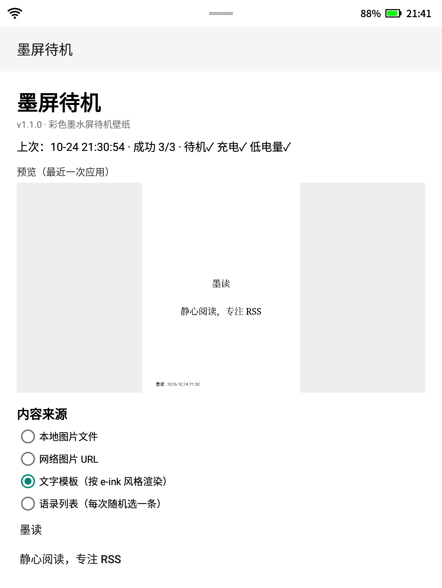

# 墨屏待机 · InkStandby

给**讯飞 XF-R3（起点阅读器，Android 11 电子墨水屏）**用的**锁屏/待机图设置 App**：
支持本地图片、网络图片 URL、文字模板、语录列表四种内容源，在**按下电源键退出待机（亮屏）时更新一次**，不做频繁轮询，省电。

| 应用界面（v1.1） | 生成的待机图（语录 + 大字号） |
|---|---|
|  |  |

## 功能

- 内容源（四选一）：
  1. **本地图片文件**（App 内也可直接「选择图片文件」导入）
  2. **网络图片 URL**（亮屏时下载，失败自动沿用上次缓存；可点「测试下载并解码」）
  3. **文字模板**（按 e-ink 风格渲染，支持 `{date}` `{time}` `{weekday}` `{battery}` 变量）
  4. **语录列表**（每行一条，每次亮屏随机选一条渲染，适合当电子墨水屏的「每日一句」）
- **实时预览**：主界面直接显示最近一次应用的待机图
- **排版选项**：字号（小 / 中 / 大）、对齐（居中 / 左对齐）、底部时间/签名开关；中文标点自动「悬挂」，避免句号被挤到下一行
- **图片选项**：适应 / 裁剪 / 拉伸三种适配方式，白底或黑底
- **内容不变时跳过**：日期/电量等内容没变化就不重复刷新，减少墨水屏闪烁
- 输出竖屏 1264×1680 + 横屏 1680×1264，同时覆盖 **待机 / 充电 / 低电量** 三种状态
- 触发时机：**亮屏（`SCREEN_ON` / `USER_PRESENT`）** 时更新一次；开机时更新；App 内「立即应用」手动更新；通知栏「立即更新」快捷操作
- 低优先级常驻通知的前台服务，不亮屏时完全不工作

## 原理（为什么只改文件不够）

XF-R3 的「锁屏壁纸」实际是 e-ink 待机图，由 system_server 里的 `IFinkWallpaper` 持有：

- 图片文件：`/data/local/iflytek/wallpaper/standby*.png`、`sleep_rotation_*.png`
- 只替换文件不会即时生效（系统内存中有缓存，启动时加载）；需要调用 **`android.iflyink.IFinkManager.setWallpaper(which, rotation, bitmap)`**（`ifink` binder 服务）刷新
- 本 App 通过反射调用（本机是 userdebug、`ro.debuggable=1`，隐藏 API 可用）：
  1. `android.util.EinkUtil.setWallpaper(...)` 落盘（权限不足时自动跳过）
  2. `android.iflyink.IFinkManager.setWallpaper(...)` 刷新系统显示
- `which`：`0` = 待机，`4` = 充电，`5` = 低电量

## 环境要求

- 目标设备：讯飞 XF-R3 / 同厂商 e-ink 设备，Android 11 **userdebug** 构建，SELinux Permissive
- 系统会显示厂商的「锁屏/待机」页（`com.iflytek.ainote.settings` 的 LockScreenActivity），本 App 只负责替换壁纸
- 构建：JDK 17–21、Android SDK（compileSdk 36 / build-tools 36.0.0）

## 构建

```bash
# 首次构建需要 local.properties 指向 SDK，或设置 ANDROID_HOME/ANDROID_SDK_ROOT
./gradlew :app:assembleRelease
# 产物：app/build/outputs/apk/release/app-release.apk
```

安装：

```bash
adb install -r app/build/outputs/apk/release/app-release.apk
```

安装后**手动打开一次** App（解除 Android 的 stopped 状态，否则收不到 `BOOT_COMPLETED`）。

## 使用

1. 打开「墨屏待机」；
2. 选内容源（本地图片 / URL / 文字模板），必要时点「选择图片文件」；
3. 点「立即应用」预览效果；
4. 之后每次**按电源键唤醒后稍等 1~2 秒**，再休眠，就会显示最新图；
5. 语录模式下每次亮屏随机换一条；内容没变化时默认跳过刷新。

## 可选：阻止厂商覆盖待机图

不做也能用，但厂商可能把图换回「讯飞有声书 / 起点日历广告」：

```bash
adb shell pm disable-user com.qidian.eink
adb shell pm disable com.iflytek.ainote.settings/.service.ScheduleSleepWallPaperCreateService
adb shell pm disable com.iflytek.ainote.settings/.receiver.WallpaperReceiver
```

恢复：

```bash
adb shell pm enable com.qidian.eink
adb shell pm enable com.iflytek.ainote.settings/.service.ScheduleSleepWallPaperCreateService
adb shell pm enable com.iflytek.ainote.settings/.receiver.WallpaperReceiver
```

## 已知限制

- 依赖 userdebug 构建的隐藏 API；正式 user 固件上反射可能被拦截。
- 亮屏后约 1~2 秒完成更新，建议唤醒后稍等再休眠。
- 通知栏会有一个低优先级常驻通知（前台服务所需）。
- 目前针对 XF-R3 的壁纸服务实现硬编码（`ifink`），其他机型需要调整。

## License

MIT
